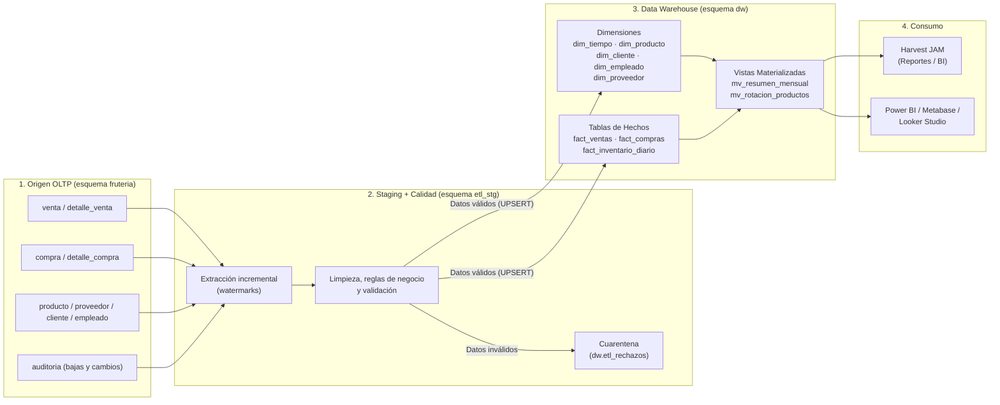
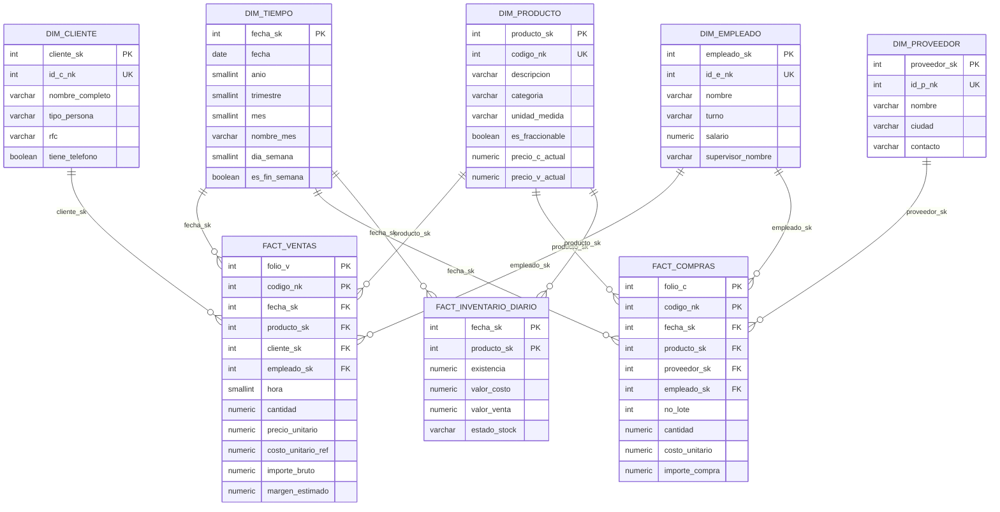

# Arquitectura y Guía de Implementación de ETL · Harvest JAM

Este documento define los **objetivos**, el **modelo dimensional** y el **plan técnico paso a paso** para implementar un pipeline **ETL (Extract, Transform, Load)** sobre la base de datos PostgreSQL de **Harvest JAM** (`esquema fruteria`), manteniendo la filosofía ligera del proyecto (**Node.js + `pg` + PostgreSQL**).

---

## 1. Contexto y Justificación

Actualmente, Harvest JAM opera sobre un esquema transaccional **OLTP** (`fruteria`) compuesto por 13 tablas optimizadas para cobro rápido en caja, compras y control de stock en tiempo real.

Sin embargo, conforme crecen las ventas, las compras y los cambios de precios:

- Consultar analítica pesada (comparativos interanuales, márgenes históricos, rotación de inventario, desempeño por turno) directamente sobre tablas operativas aumenta la carga durante horas pico en caja.
- Las entidades de clientes están normalizadas en tres tablas (`cliente`, `p_fisica`, `p_moral`), y los empleados/supervisores en dos (`empleado`, `supervisor`), lo que vuelve complejas las consultas analíticas.
- El inventario actual (`producto.existencia`) solo refleja la **foto de hoy**, pero no guarda el historial diario de stock ni el histórico de costos para evaluar merma o quiebres de inventario pasados.

Un proceso **ETL** resuelve esto trasladando, limpiando y modelando los datos operativos hacia un esquema analítico dedicado (**Data Warehouse `dw`**).

---

## 2. Objetivos del ETL

### Objetivo general
Diseñar e implementar un pipeline ETL automatizado, incremental e idempotente que transforme los datos operativos del esquema `fruteria` en un modelo dimensional en estrella (`dw`) dentro de PostgreSQL, habilitando análisis histórico confiable, reportes instantáneos y soporte a la toma de decisiones sin afectar el rendimiento del punto de venta.

### Objetivos específicos

1. **Desacoplar operación y analítica (OLTP vs. OLAP):** Evitar que reportes complejos o herramientas externas de BI bloqueen o ralenticen el registro de ventas (`venta`, `detalle_venta`) y compras (`compra`, `detalle_compra`).
2. **Consolidar y limpiar los datos de origen:** Unificar jerarquías normalizadas (`cliente` + `p_fisica` + `p_moral`, `empleado` + `supervisor`), estandarizar texto (capitalización, espacios, teléfonos/RFC) y detectar anomalías antes de cargarlas.
3. **Preservar el historial de inventario y márgenes:** Generar fotografías diarias (*snapshots*) de existencias y costos en `dw.fact_inventario_diario`, además de calcular métricas listas para consulta (`importe_bruto`, `costo_estimado`, `margen_estimado`).
4. **Garantizar cargas incrementales e idempotentes:** Procesar únicamente registros nuevos o modificados mediante marcas de agua (*watermarks*) y operaciones `UPSERT`, asegurando que re-ejecutar el ETL nunca duplique montos ni folios.
5. **Integrar conciliación y trazabilidad completa:** Registrar cada corrida (duración, filas procesadas, rechazos, errores) en `dw.etl_ejecuciones` y cuadrar totales contra `fruteria` automáticamente.
6. **Respetar la seguridad por roles existente:** Otorgar ejecución y mantenimiento al rol `administrador` y acceso de solo lectura analítica a `gerente` y `contador`, alineado con `base-de-datos/04_roles.sql`.

### Preguntas de negocio que habilitará el ETL

| Área | Preguntas clave / KPIs |
|---|---|
| **Ventas y Rentabilidad** | Margen bruto real por producto, categoría y mes; ticket promedio por turno; horas pico por día de la semana. |
| **Inventario y Merma** | Días de inventario disponible; histórico de productos agotados o en stock bajo; valor del inventario día por día. |
| **Clientes** | Frecuencia de recompra, clientes más rentables, distribución Personas Físicas vs. Morales vs. Mostrador. |
| **Compras y Proveedores** | Evolución del costo unitario por proveedor/producto, concentración de gasto por ciudad y lotes recibidos. |
| **Operación y Personal** | Productividad por cajero y turno (`matutino`, `vespertino`, `nocturno`), tasa de cancelaciones. |

---

## 3. Arquitectura del Pipeline ETL



---

## 4. Modelo Dimensional (Esquema Estrella en `dw`)



### Definición del grano de cada tabla de hechos
- **`dw.fact_ventas`**: Un registro por **renglón de ticket** (`folio_v`, `codigo_nk`). Permite sumar por día, hora, producto, categoría, cliente o vendedor sin pérdida de detalle.
- **`dw.fact_compras`**: Un registro por **renglón de orden de compra** (`folio_c`, `codigo_nk`).
- **`dw.fact_inventario_diario`**: Un registro por **producto por día** (`fecha_sk`, `producto_sk`), capturado al cierre diario o al ejecutar el ETL.

---

## 5. Reglas de Extracción, Transformación y Carga (E → T → L)

### E · Extracción (Extract)
- **Catálogos (Dimensiones):** Extracción completa ligera (son catálogos de decenas/cientos de filas: `producto`, `cliente` + `p_fisica` + `p_moral`, `empleado` + `supervisor`, `proveedor`) para detectar cualquier edición de nombre, turno, precio o ciudad.
- **Hechos (Incremental por marca de agua):**
  - `ventas`: extraer folios con `v.folio_v > ultimo_folio_v` (guardado en `dw.etl_watermarks`).
  - `compras`: extraer folios con `c.folio_c > ultimo_folio_c`.
- **Sincronización de cancelaciones / eliminaciones:**
  - En Harvest JAM un administrador puede cancelar una venta o eliminar una compra (lo cual borra filas en `fruteria.venta` / `fruteria.compra` y registra una `DELETE` en `fruteria.auditoria`).
  - El paso de sincronización elimina de `dw.fact_ventas` / `dw.fact_compras` cualquier folio que ya no exista en la tabla operativa (o mediante ventana móvil de los últimos 90 días), manteniendo 100 % de exactitud contable.

### T · Transformación (Transform)
1. **Unificación de clientes:**
   - `COALESCE(pf.nombre, pm.razon_social, 'Público en general')`
   - Clasificación `tipo_persona`: `'mostrador'` si `rfc = 'XAXX010101000'`, `'fisica'` si existe en `p_fisica`, `'moral'` si existe en `p_moral`.
2. **Normalización textual:**
   - Recorte de espacios (`trim`), colapso de dobles espacios, homologación de categorías en minúsculas limpias (`fruta`, `verdura`) y formato de nombre propio consistente.
3. **Derivación de atributos de negocio:**
   - `fecha_sk = TO_CHAR(fecha, 'YYYYMMDD')::INT`
   - `hora = EXTRACT(HOUR FROM fecha)::SMALLINT`
   - `es_fraccionable = unidad_medida IN ('kilogramo', 'litro')`
   - `importe_bruto = ROUND(cantidad * precio_unitario, 2)`
   - `costo_unitario_ref`: último costo de compra del producto a la fecha de la venta (o `producto.precio_c` si no hay compra previa).
   - `margen_estimado = ROUND(importe_bruto - (cantidad * costo_unitario_ref), 2)`
   - `estado_stock`: `'agotado'` (`existencia <= 0`), `'bajo'` (`existencia <= UMBRAL_STOCK_BAJO`), `'disponible'` (resto).
4. **Reglas de calidad (cuarentena en `dw.etl_rechazos`):**
   - Rechazar y registrar (sin tumbar el resto del lote) si `cantidad <= 0`, `precio_unitario < 0`, `fecha IS NULL` o llave de producto inexistente.

### L · Carga (Load)
- Toda la corrida ocurre en **transacciones controladas** en PostgreSQL.
- **Idempotencia garantizada:** Uso de `INSERT ... ON CONFLICT (...) DO UPDATE` tanto en dimensiones como en tablas de hechos.
- Al completar con éxito:
  1. Actualiza `dw.etl_watermarks`.
  2. Refresca vistas materializadas (`REFRESH MATERIALIZED VIEW CONCURRENTLY`).
  3. Ejecuta la verificación de conciliación contable y guarda el resultado en `dw.etl_ejecuciones`.

---

## 6. Implementación Paso a Paso en Harvest JAM

### Paso 1 · Crear el esquema analítico (`base-de-datos/07_dw_esquema.sql`)

Crea el archivo `base-de-datos/07_dw_esquema.sql` y ejecútalo como `postgres` sobre la base de datos del proyecto:

```sql
-- =====================================================================
-- HARVEST JAM · 07_dw_esquema.sql — Data Warehouse (Esquema dw)
-- =====================================================================

create schema if not exists dw authorization postgres;

-- ---------------------------------------------------------------------
-- 1. Tablas de control del ETL
-- ---------------------------------------------------------------------
create table if not exists dw.etl_ejecuciones (
    id                 bigserial primary key,
    iniciado_en        timestamp(0) not null default localtimestamp(0),
    terminado_en       timestamp(0),
    modo               varchar(20)  not null default 'incremental', -- incremental | completo
    estado             varchar(20)  not null default 'en_curso',    -- en_curso | ok | error
    filas_extraidas    integer      not null default 0,
    filas_cargadas     integer      not null default 0,
    filas_rechazadas   integer      not null default 0,
    conciliacion_ok    boolean,
    detalle_error      text
);

create table if not exists dw.etl_watermarks (
    entidad          varchar(50) primary key,
    ultimo_id        bigint      not null default 0,
    actualizado_en   timestamp(0) not null default localtimestamp(0)
);

insert into dw.etl_watermarks (entidad, ultimo_id)
values ('ventas', 0), ('compras', 0)
on conflict (entidad) do nothing;

create table if not exists dw.etl_rechazos (
    id             bigserial primary key,
    ejecucion_id   bigint references dw.etl_ejecuciones (id) on delete cascade,
    entidad        varchar(50) not null,
    clave_origen   varchar(80),
    motivo         text not null,
    payload        jsonb,
    creado_en      timestamp(0) not null default localtimestamp(0)
);

-- ---------------------------------------------------------------------
-- 2. Dimensiones
-- ---------------------------------------------------------------------
create table if not exists dw.dim_tiempo (
    fecha_sk        integer primary key, -- YYYYMMDD
    fecha           date        not null unique,
    anio            smallint    not null,
    trimestre       smallint    not null,
    mes             smallint    not null,
    nombre_mes      varchar(20) not null,
    semana_anio     smallint    not null,
    dia_mes         smallint    not null,
    dia_semana      smallint    not null, -- 1=Lun .. 7=Dom
    nombre_dia      varchar(20) not null,
    es_fin_semana   boolean     not null
);

create table if not exists dw.dim_producto (
    producto_sk      integer generated always as identity primary key,
    codigo_nk        integer       not null unique,
    descripcion      varchar(100)  not null,
    categoria        varchar(50)   not null,
    unidad_medida    varchar(20)   not null,
    es_fraccionable  boolean       not null,
    precio_c_actual  numeric(8,2)  not null,
    precio_v_actual  numeric(8,2)  not null,
    actualizado_en   timestamp(0)  not null default localtimestamp(0)
);

create table if not exists dw.dim_cliente (
    cliente_sk       integer generated always as identity primary key,
    id_c_nk          integer       not null unique,
    nombre_completo  varchar(120)  not null,
    tipo_persona     varchar(20)   not null, -- fisica | moral | mostrador
    rfc              varchar(16),
    tiene_telefono   boolean       not null,
    actualizado_en   timestamp(0)  not null default localtimestamp(0)
);

create table if not exists dw.dim_empleado (
    empleado_sk        integer generated always as identity primary key,
    id_e_nk            integer       not null unique,
    nombre             varchar(80)   not null,
    turno              varchar(20)   not null,
    salario            numeric(14,2) not null,
    supervisor_nombre  varchar(80),
    actualizado_en     timestamp(0)  not null default localtimestamp(0)
);

create table if not exists dw.dim_proveedor (
    proveedor_sk    integer generated always as identity primary key,
    id_p_nk         integer      not null unique,
    nombre          varchar(100) not null,
    ciudad          varchar(50)  not null,
    contacto        varchar(100),
    actualizado_en  timestamp(0) not null default localtimestamp(0)
);

-- ---------------------------------------------------------------------
-- 3. Tablas de Hechos
-- ---------------------------------------------------------------------
create table if not exists dw.fact_ventas (
    folio_v             integer       not null,
    codigo_nk           integer       not null,
    fecha_sk            integer       not null references dw.dim_tiempo (fecha_sk),
    producto_sk         integer       not null references dw.dim_producto (producto_sk),
    cliente_sk          integer       references dw.dim_cliente (cliente_sk),
    empleado_sk         integer       references dw.dim_empleado (empleado_sk),
    hora                smallint      not null,
    cantidad            numeric(10,3) not null,
    precio_unitario     numeric(8,2)  not null,
    costo_unitario_ref  numeric(8,2)  not null,
    importe_bruto       numeric(12,2) not null,
    costo_estimado      numeric(12,2) not null,
    margen_estimado     numeric(12,2) not null,
    primary key (folio_v, codigo_nk)
);

create table if not exists dw.fact_compras (
    folio_c          integer       not null,
    codigo_nk        integer       not null,
    fecha_sk         integer       not null references dw.dim_tiempo (fecha_sk),
    producto_sk      integer       not null references dw.dim_producto (producto_sk),
    proveedor_sk     integer       not null references dw.dim_proveedor (proveedor_sk),
    empleado_sk      integer       references dw.dim_empleado (empleado_sk),
    no_lote          integer,
    cantidad         numeric(10,3) not null,
    costo_unitario   numeric(8,2)  not null,
    importe_compra   numeric(12,2) not null,
    primary key (folio_c, codigo_nk)
);

create table if not exists dw.fact_inventario_diario (
    fecha_sk      integer       not null references dw.dim_tiempo (fecha_sk),
    producto_sk   integer       not null references dw.dim_producto (producto_sk),
    existencia    numeric(10,3) not null,
    valor_costo   numeric(12,2) not null,
    valor_venta   numeric(12,2) not null,
    estado_stock  varchar(20)   not null, -- agotado | bajo | disponible
    primary key (fecha_sk, producto_sk)
);

-- Índices analíticos
create index if not exists idx_fv_fecha    on dw.fact_ventas (fecha_sk);
create index if not exists idx_fv_producto on dw.fact_ventas (producto_sk);
create index if not exists idx_fv_cliente  on dw.fact_ventas (cliente_sk);
create index if not exists idx_fc_fecha    on dw.fact_compras (fecha_sk);
create index if not exists idx_fc_prov     on dw.fact_compras (proveedor_sk);

-- ---------------------------------------------------------------------
-- 4. Función auxiliar para poblar dw.dim_tiempo (ej. 2023 a 2030)
-- ---------------------------------------------------------------------
create or replace function dw.poblar_dim_tiempo(desde date, hasta date)
returns integer language plpgsql as $$
declare
    total integer;
begin
    insert into dw.dim_tiempo (
        fecha_sk, fecha, anio, trimestre, mes, nombre_mes,
        semana_anio, dia_mes, dia_semana, nombre_dia, es_fin_semana
    )
    select
        to_char(d, 'YYYYMMDD')::int,
        d::date,
        extract(year from d)::smallint,
        extract(quarter from d)::smallint,
        extract(month from d)::smallint,
        (array['Enero','Febrero','Marzo','Abril','Mayo','Junio',
               'Julio','Agosto','Septiembre','Octubre','Noviembre','Diciembre'])[extract(month from d)::int],
        extract(week from d)::smallint,
        extract(day from d)::smallint,
        extract(isodow from d)::smallint,
        (array['Lunes','Martes','Miércoles','Jueves','Viernes','Sábado','Domingo'])[extract(isodow from d)::int],
        extract(isodow from d) in (6, 7)
    from generate_series(desde, hasta, interval '1 day') as d
    on conflict (fecha_sk) do nothing;

    get diagnostics total = row_count;
    return total;
end;
$$;

select dw.poblar_dim_tiempo('2023-01-01', '2030-12-31');

-- ---------------------------------------------------------------------
-- 5. Vista materializada para reportes instantáneos
-- ---------------------------------------------------------------------
create materialized view if not exists dw.mv_ventas_mensuales as
select
    t.anio,
    t.mes,
    t.nombre_mes,
    p.categoria,
    count(distinct f.folio_v)  as tickets,
    sum(f.cantidad)            as unidades,
    sum(f.importe_bruto)       as ingresos,
    sum(f.costo_estimado)      as costos,
    sum(f.margen_estimado)     as margen
from dw.fact_ventas f
join dw.dim_tiempo t   on t.fecha_sk = f.fecha_sk
join dw.dim_producto p on p.producto_sk = f.producto_sk
group by t.anio, t.mes, t.nombre_mes, p.categoria;

create unique index if not exists idx_mv_ventas_mensuales
    on dw.mv_ventas_mensuales (anio, mes, categoria);

-- ---------------------------------------------------------------------
-- 6. Permisos alineados con 04_roles.sql
-- ---------------------------------------------------------------------
grant usage on schema dw to administrador, gerente, contador;
grant all privileges on all tables    in schema dw to administrador;
grant all privileges on all sequences in schema dw to administrador;
grant select         on all tables    in schema dw to gerente, contador;
```

---

### Paso 2 · Estructura del módulo ETL en el servidor (`server/src/etl/`)

Aprovechando el mismo stack de Node.js + `pg` ya instalado en `server/`, agrega esta estructura modular:

```text
server/
  src/
    etl/
      index.js       # Orquestador principal: abre corrida, coordina E-T-L, concilia y cierra bitácora
      extract.js     # Consultas incrementales sobre fruteria.* usando dw.etl_watermarks
      transform.js   # Normalización, cálculos de margen, validación y separación de rechazos
      load.js        # UPSERT de dimensiones, hechos, snapshot diario y sincronización de bajas
      cli.js         # Punto de entrada para ejecutar desde terminal o cron (npm run etl)
    rutas/
      etl.js         # (Opcional) Endpoints GET /api/etl/estado y POST /api/etl/ejecutar (solo administrador)
```

---

### Paso 3 · Ejemplo del Orquestador ETL en Node.js (`server/src/etl/index.js`)

```js
import pg from 'pg';

const UMBRAL_STOCK_BAJO = Number(process.env.UMBRAL_STOCK_BAJO ?? 10);

export async function ejecutarEtl(pool, { modo = 'incremental' } = {}) {
  const client = await pool.connect();
  let ejecucionId = null;

  try {
    // 1. Abrir registro de ejecución
    const { rows: [corrida] } = await client.query(
      `insert into dw.etl_ejecuciones (modo, estado) values ($1, 'en_curso') returning id`,
      [modo],
    );
    ejecucionId = corrida.id;

    await client.query('begin');

    // 2. Cargar / actualizar dimensiones (UPSERT idempotente)
    await cargarDimensiones(client);

    // 3. Leer marcas de agua (si modo === 'completo', arranca desde 0)
    const { rows: wms } = await client.query(`select entidad, ultimo_id from dw.etl_watermarks`);
    const wm = Object.fromEntries(wms.map((r) => [r.entidad, modo === 'completo' ? 0 : Number(r.ultimo_id)]));

    // 4. Extraer + Transformar + Cargar hechos incrementales
    const resVentas = await procesarVentas(client, ejecucionId, wm.ventas);
    const resCompras = await procesarCompras(client, ejecucionId, wm.compras);

    // 5. Sincronizar cancelaciones/bajas ocurridas en el OLTP
    await client.query(`
      delete from dw.fact_ventas fv
      where not exists (
        select 1 from fruteria.detalle_venta dv
        where dv.folio_v = fv.folio_v and dv.codigo = fv.codigo_nk
      )
    `);
    await client.query(`
      delete from dw.fact_compras fc
      where not exists (
        select 1 from fruteria.detalle_compra dc
        where dc.folio_c = fc.folio_c and dc.codigo = fc.codigo_nk
      )
    `);

    // 6. Snapshot diario de inventario
    await cargarSnapshotInventario(client, UMBRAL_STOCK_BAJO);

    // 7. Actualizar marcas de agua
    if (resVentas.maxFolio > wm.ventas) {
      await client.query(
        `update dw.etl_watermarks set ultimo_id = $1, actualizado_en = localtimestamp(0) where entidad = 'ventas'`,
        [resVentas.maxFolio],
      );
    }
    if (resCompras.maxFolio > wm.compras) {
      await client.query(
        `update dw.etl_watermarks set ultimo_id = $1, actualizado_en = localtimestamp(0) where entidad = 'compras'`,
        [resCompras.maxFolio],
      );
    }

    // 8. Conciliación contable automática (OLTP vs DW)
    const { rows: [conc] } = await client.query(`
      select
        coalesce((select round(sum(cantidad * precio_unitario), 2) from fruteria.detalle_venta), 0) as oltp,
        coalesce((select round(sum(importe_bruto), 2) from dw.fact_ventas), 0)                     as dw
    `);
    const conciliacionOk = Number(conc.oltp) === Number(conc.dw);

    await client.query('commit');

    // 9. Refrescar vistas materializadas fuera de la transacción principal
    await client.query(`refresh materialized view concurrently dw.mv_ventas_mensuales`);

    // 10. Cerrar corrida como exitosa
    const extraidas = resVentas.extraidas + resCompras.extraidas;
    const cargadas = resVentas.cargadas + resCompras.cargadas;
    const rechazadas = resVentas.rechazadas + resCompras.rechazadas;

    await client.query(
      `update dw.etl_ejecuciones
       set terminado_en = localtimestamp(0), estado = 'ok',
           filas_extraidas = $2, filas_cargadas = $3,
           filas_rechazadas = $4, conciliacion_ok = $5
       where id = $1`,
      [ejecucionId, extraidas, cargadas, rechazadas, conciliacionOk],
    );

    return { ejecucionId, estado: 'ok', extraidas, cargadas, rechazadas, conciliacionOk };
  } catch (err) {
    await client.query('rollback').catch(() => {});
    if (ejecucionId) {
      await client.query(
        `update dw.etl_ejecuciones
         set terminado_en = localtimestamp(0), estado = 'error', detalle_error = $2
         where id = $1`,
        [ejecucionId, err.message],
      ).catch(() => {});
    }
    throw err;
  } finally {
    client.release();
  }
}
```

#### Consultas clave dentro de `load.js`

**Unificación de `dw.dim_cliente` (resuelve `cliente` + `p_fisica` + `p_moral`):**
```sql
insert into dw.dim_cliente (id_c_nk, nombre_completo, tipo_persona, rfc, tiene_telefono, actualizado_en)
select
    c.id_c,
    coalesce(nullif(trim(pf.nombre), ''), nullif(trim(pm.razon_social), ''), 'Público en general'),
    case
        when upper(trim(coalesce(c.rfc, ''))) = 'XAXX010101000' then 'mostrador'
        when pm.id_c is not null then 'moral'
        else 'fisica'
    end,
    upper(nullif(trim(c.rfc), '')),
    length(regexp_replace(coalesce(c.telefono, ''), '\D', '', 'g')) >= 10,
    localtimestamp(0)
from fruteria.cliente c
left join fruteria.p_fisica pf on pf.id_c = c.id_c
left join fruteria.p_moral  pm on pm.id_c = c.id_c
on conflict (id_c_nk) do update set
    nombre_completo = excluded.nombre_completo,
    tipo_persona    = excluded.tipo_persona,
    rfc             = excluded.rfc,
    tiene_telefono  = excluded.tiene_telefono,
    actualizado_en  = excluded.actualizado_en;
```

**Snapshot diario en `dw.fact_inventario_diario`:**
```sql
insert into dw.fact_inventario_diario (fecha_sk, producto_sk, existencia, valor_costo, valor_venta, estado_stock)
select
    to_char(current_date, 'YYYYMMDD')::int,
    dp.producto_sk,
    p.existencia,
    round(p.existencia * p.precio_c, 2),
    round(p.existencia * p.precio_v, 2),
    case
        when p.existencia <= 0 then 'agotado'
        when p.existencia <= $1 then 'bajo'
        else 'disponible'
    end
from fruteria.producto p
join dw.dim_producto dp on dp.codigo_nk = p.codigo
on conflict (fecha_sk, producto_sk) do update set
    existencia   = excluded.existencia,
    valor_costo  = excluded.valor_costo,
    valor_venta  = excluded.valor_venta,
    estado_stock = excluded.estado_stock;
```

---

### Paso 4 · Comandos y Automatización

1. **Scripts en `package.json` raíz:**
   ```json
   {
     "scripts": {
       "etl": "node --env-file=.env server/src/etl/cli.js",
       "etl:completo": "node --env-file=.env server/src/etl/cli.js --completo"
     }
   }
   ```
2. **Programación automática (eligiendo una de estas dos opciones):**
   - **Cron del sistema operativo (macOS/Linux):** ejecutar cada noche a las 23:30 (cierre de tienda) o cada hora en horario comercial:
     ```cron
     # Incremental cada hora de 8:00 a 22:00
     0 8-22 * * * cd /Users/jfmd/Documents/harvest-jam && npm run etl >> /tmp/harvest-etl.log 2>&1
     # Recálculo completo los domingos a las 02:00
     0 2 * * 0 cd /Users/jfmd/Documents/harvest-jam && npm run etl:completo >> /tmp/harvest-etl.log 2>&1
     ```
   - **Desde el propio Harvest JAM (UI):** Exponer `POST /api/etl/ejecutar` (protegido para rol `administrador`) y mostrar un botón **"Actualizar cubo analítico"** + última corrida y estado de conciliación en `/reportes`.

---

### Paso 5 · Integración con Reportes y BI Externo

- **Dentro de Harvest JAM:** Las gráficas históricas de `/reportes` pueden consultar `dw.mv_ventas_mensuales` y `dw.fact_inventario_diario` en milisegundos, habilitando además nuevas gráficas que hoy no existen:
  - Evolución histórica del valor del inventario y días con quiebre de stock.
  - Margen real por categoría y comparativo año contra año.
  - Ranking de proveedores por volumen y variación de costo unitario.
- **Herramientas BI (Power BI, Metabase, Looker Studio):** Conectar con un usuario de rol `gerente` o `contador` directamente al esquema `dw` (solo lectura). El modelo en estrella se autodetecta por sus llaves foráneas sin configuración adicional.

---

## 7. Checklist de Validación y Calidad

Antes de dar por terminada la implementación del ETL, verifica estos 5 puntos:

- [ ] **Prueba de carga inicial (`npm run etl:completo`):** Carga todo el historial de `fruteria` y registra `estado = 'ok'` en `dw.etl_ejecuciones`.
- [ ] **Prueba de conciliación contable:** `SUM(fruteria.detalle_venta.cantidad * precio_unitario)` coincide al centavo con `SUM(dw.fact_ventas.importe_bruto)` (`conciliacion_ok = true`).
- [ ] **Prueba de idempotencia:** Ejecutar `npm run etl` dos veces seguidas sin nuevas ventas produce **0 duplicados** y los mismos totales.
- [ ] **Prueba de cancelación:** Cancelar una venta desde `/ventas` y correr `npm run etl` elimina el folio correspondiente en `dw.fact_ventas`.
- [ ] **Prueba de permisos:** Confirmar que `cajero` no tiene acceso al esquema `dw`, mientras `gerente` y `contador` solo tienen `SELECT` y `administrador` puede ejecutar cargas.
