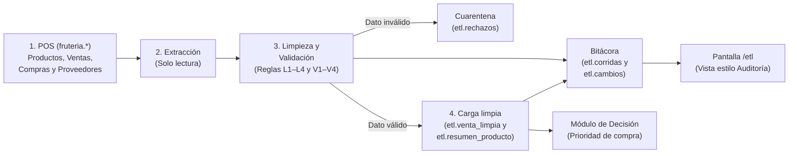

# Manual Simple del ETL · Harvest JAM

> **Para el equipo:** Este documento explica, en palabras sencillas, cómo funciona el ETL de Harvest JAM, qué tablas y archivos usa y cómo defender cada parte en la presentación final.

---

## 1. Glosario rápido (7 conceptos en una frase)

- **ETL:** Proceso de 3 pasos (**Extraer**, **Transformar** y **Cargar**) que toma los datos del sistema de caja, los limpia y los deja listos para analizar decisiones.
- **Extracción:** Leer los datos originales desde las tablas del POS (`fruteria.*`) sin modificarlos.
- **Transformación:** Limpiar, corregir y validar esos datos (quitar espacios, unificar unidades, detectar errores) y calcular indicadores.
- **Carga:** Guardar los datos ya limpios en tablas aparte para que el módulo de decisión los use.
- **Bitácora:** Historial donde queda anotado qué hizo el ETL, cuándo corrió y qué cambió en cada dato (antes → después).
- **Cuarentena:** Tabla aparte donde se guardan los datos inválidos o rotos para que no arruinen los cálculos.
- **Idempotencia:** Garantía de que, si corres el ETL dos veces seguidas con los mismos datos, obtienes exactamente el mismo resultado y sin duplicados.

---

## 2. La Regla de Oro

**El ETL solo LEE del POS (`fruteria.*`) y ESCRIBE en un esquema aparte (`etl.*`). Nunca modifica ni borra datos del punto de venta.**

> **Cómo explicarlo en la defensa:** *"Separamos las tablas de caja de las tablas de análisis para que cualquier limpieza, prueba o error del ETL jamás afecte las ventas ni el inventario real de la frutería."*

---

## 3. ¿Cómo funciona paso a paso?



El ETL tiene solo **2 modos de ejecución**:

1. **Modo `completo` (el normal):** Lee los datos reales de `fruteria.*`, los limpia, valida, vacía las tablas limpias anteriores y vuelve a llenarlas desde cero dentro de una sola transacción.
   > **Cómo explicarlo en la defensa:** *"En lugar de lógica complicada para detectar cambios uno por uno, el ETL reconstruye las tablas limpias desde cero cada vez que corre. Así siempre reflejan la realidad exacta del POS y nunca duplican datos."*
2. **Modo `prueba` (para la demostración):** Procesa un pequeño paquete de **datos sucios e inválidos inventados a propósito** (por ejemplo, una cantidad negativa o una fecha del futuro) sin tocar las tablas reales ni ensuciar los indicadores. Solo guarda lo que pasó en la bitácora y en cuarentena para verlo en pantalla.
   > **Cómo explicarlo en la defensa:** *"El modo de prueba nos permite demostrar en vivo cómo el ETL limpia un dato sucio y rechaza un dato inválido sin alterar los datos reales del negocio."*

### ¿Por qué es reproducible (idempotente)?
Porque dentro de una transacción de PostgreSQL (`BEGIN ... COMMIT`), el ETL reemplaza el contenido de las tablas limpias (`TRUNCATE` + `INSERT`) con el resultado recién calculado. Si algo falla a la mitad, PostgreSQL hace `ROLLBACK` y deja todo como estaba. Si lo corres 2 o 10 veces seguidas, el resultado es idéntico.

> **Cómo explicarlo en la defensa:** *"Usamos una transacción que reemplaza las tablas limpias en bloque; por eso correr el ETL dos veces produce exactamente las mismas cifras y cero duplicados."*

---

## 4. Las 5 tablas del esquema `etl` (sin complicaciones)

En la **misma base de datos PostgreSQL** de Harvest JAM se agrega el esquema `etl` con solo **5 tablas** de nombres obvios:

### Tablas de control y trazabilidad (3)
| Tabla | Qué guarda | Para qué sirve |
|---|---|---|
| **`etl.corridas`** | Una fila por cada ejecución (fecha, modo `completo`/`prueba`, quién lo corrió, estado, cuántos registros entraron, cuántos se limpiaron y cuántos se rechazaron) | Saber cuándo fue la última actualización y si salió bien |
| **`etl.cambios`** | Cada cambio hecho a un dato: `corrida_id`, `entidad`, `clave` (código o folio), `tipo` (`LIMPIADO`, `RECHAZADO`, `CARGADO`), `regla`, `valor_antes`, `valor_despues` y `motivo` | Alimentar la pantalla `/etl` (estilo Auditoría) para ver el *antes → después* |
| **`etl.rechazos`** | Copia del dato inválido que no pasó validación (`corrida_id`, `entidad`, `clave`, `regla`, `motivo`, `dato_original` en JSON) | Cuarentena: ver qué datos malos se frenaron sin romper la corrida |

> **Cómo explicarlo en la defensa:** *"Estas tres tablas son la evidencia de nuestro ETL: `corridas` dice cuándo corrió, `cambios` muestra cada arreglo paso a paso y `rechazos` guarda en cuarentena lo que no pasó las reglas de calidad."*

### Tablas de resultado limpio (2)
| Tabla | Qué guarda | Qué contiene |
|---|---|---|
| **`etl.venta_limpia`** | Cada renglón de venta ya validado | `folio_v`, `fecha`, `codigo`, `producto`, `categoria`, `unidad_medida`, `cantidad`, `precio_unitario`, `costo_unitario`, `importe`, `margen` |
| **`etl.resumen_producto`** | Una fila por producto lista para decidir qué comprar | **Variables:** `codigo`, `descripcion`, `categoria`, `unidad_medida`, `existencia`, `precio_c`, `precio_v`, `proveedor_principal`.<br>**Indicadores:** `demanda_diaria`, `dias_cobertura`, `rotacion`, `margen_pct`, `datos_suficientes` |

> **Cómo explicarlo en la defensa:** *"No hicimos un modelo dimensional complejo con llaves artificiales; dejamos dos tablas limpias con los mismos códigos de producto del POS para que cualquiera pueda leerlas y entender de dónde sale cada número."*

---

## 5. Reglas de limpieza y validación (las 8 esenciales)

### 4 reglas de limpieza (corrigen el dato y sí entra)

| Código | Nombre | Qué hace |
|---|---|---|
| **`L1`** | **Texto limpio** | Quita espacios sobrantes y unifica mayúsculas/minúsculas en nombres de productos y proveedores. |
| **`L2`** | **Categoría estándar** | Unifica categorías a minúsculas (`"FRUTAS "` → `"fruta"`). Si viene vacía, pone `"sin_clasificar"`. |
| **`L3`** | **Unidad estándar** | Convierte abreviaturas a la unidad oficial (`"kg"` / `"kilo"` → `"kilogramo"`, `"pza"` → `"pieza"`). |
| **`L4`** | **Sin duplicados** | Si llegan dos renglones repetidos con el mismo `(folio, codigo)` en el mismo lote, deja solo uno y anota el cambio. |

### 4 reglas de validación (frenan el dato malo → Cuarentena)

| Código | Nombre | Cuándo rechaza el registro |
|---|---|---|
| **`V1`** | **Producto válido** | Si el código está vacío o no existe en el catálogo de productos. |
| **`V2`** | **Cantidad y stock válidos** | Si la cantidad vendida es `<= 0`, o si la existencia es negativa (`< 0`). |
| **`V3`** | **Precio válido** | Si el precio de venta es `<= 0` o el costo es negativo (`< 0`). |
| **`V4`** | **Fecha válida** | Si la fecha está vacía, mal escrita o está en el futuro (mayor a hoy). |

> **Cómo explicarlo en la defensa:** *"Tenemos 4 reglas de limpieza (`L1` a `L4`) para arreglar problemas de formato y 4 reglas de validación (`V1` a `V4`) para frenar datos imposibles y mandarlos a cuarentena."*

---

## 6. Dos ejemplos concretos (Antes → Después)

### Ejemplo 1 · Dato sucio que SÍ se limpia
- **Entrada (Antes):**
  ```json
  { "codigo": 5104, "descripcion": "  cebolla   BLANCA ", "categoria": "VERDURAS", "unidad_medida": "kg", "existencia": 5, "precio_c": 18, "precio_v": 30 }
  ```
- **Qué hace el ETL:** Aplica `L1` (texto), `L2` (categoría) y `L3` (unidad). Luego pasa `V1`–`V4` sin problema.
- **Resultado (Después):**
  ```json
  { "codigo": 5104, "descripcion": "Cebolla blanca", "categoria": "verdura", "unidad_medida": "kilogramo", "existencia": 5, "precio_c": 18, "precio_v": 30 }
  ```
- **Qué queda en `/etl`:** 3 filas con etiqueta **`Limpiado`** mostrando exactamente `"  cebolla   BLANCA " → "Cebolla blanca"`, `"VERDURAS" → "verdura"` y `"kg" → "kilogramo"`.

### Ejemplo 2 · Dato inválido que SE RECHAZA (Cuarentena)
- **Entrada (Antes):**
  ```json
  { "folio_v": 99901, "fecha": "2099-05-01", "codigo": 5104, "cantidad": -4, "precio_unitario": 30 }
  ```
- **Qué hace el ETL:** Falla **`V2`** (cantidad `-4 <= 0`) y **`V4`** (fecha futura `2099-05-01`).
- **Resultado (Después):**
  - **NO entra** a `etl.venta_limpia` (no altera ningún indicador).
  - Se guarda el JSON original en `etl.rechazos`.
  - Aparece en `/etl` con etiqueta roja **`Rechazado`** y motivo claro: *"Cantidad menor o igual a cero y fecha futura"*.

---

## 7. Dónde vive cada pieza en el proyecto

Se usa exactamente la misma tecnología actual (PostgreSQL + Express + React), solo agregando archivos nuevos bien ordenados:

```text
harvest-jam/
├── base-de-datos/
│   └── 07_etl.sql                 # Crea el esquema etl y sus 5 tablas + permisos
├── server/src/
│   ├── etl/
│   │   ├── ejecutar.js            # Orquesta los pasos: extraer → limpiar → validar → cargar
│   │   ├── reglas.js              # Las 4 reglas L1–L4 y 4 reglas V1–V4 (fáciles de leer y probar)
│   │   └── datosPrueba.js         # Los casos sucios/inválidos para el botón "Probar datos inválidos"
│   └── rutas/
│       └── etl.js                 # Endpoints: GET /api/etl/resumen, GET /api/etl/cambios, POST /api/etl/ejecutar
└── client/src/paginas/
    └── BitacoraEtl.jsx            # Pantalla /etl con diseño igual al de Auditoría
```

> **Cómo explicarlo en la defensa:** *"El código del ETL está separado en tres archivos pequeños en el servidor (`reglas.js`, `ejecutar.js` y `datosPrueba.js`), conectados a una sola pantalla `/etl` para que cualquier integrante del equipo pueda leerlo y explicarlo."*

### Permisos (misma lógica de roles que ya tiene Harvest JAM)
- **`administrador`**: ve `/etl` y puede ejecutar el ETL y el modo de prueba.
- **`gerente` y `contador`**: ven `/etl` en solo lectura.
- **`comprador`, `cajero` y `admin_clientes`**: no ven `/etl` (el `comprador` sí verá la pantalla de decisiones).

---

## 8. La pantalla `/etl` (vista estilo Auditoría)

Reutiliza el mismo diseño y componentes de [Auditoria.jsx](../client/src/paginas/Auditoria.jsx):

1. **Arriba:** título **Bitácora ETL**, botón **Ejecutar ETL** (modo `completo`) y botón **Probar datos inválidos** (modo `prueba`).
2. **Resumen de la última corrida:** 4 cifras clave (**Extraídos**, **Limpiados**, **Cargados** y **Rechazados**).
3. **Filtros:** selector de corrida, filtro por tipo (`Todos`, `Limpiados`, `Rechazados`, `Cargados`) y buscador por código, folio o regla (`L1`, `V2`, etc.).
4. **Tabla paginada:** columnas `Cuándo`, `Corrida`, `Entidad / Clave`, `Resultado`, `Regla`, `Antes → Después` y `Motivo`. Al hacer clic en una fila se abre un modal con el dato original y el dato final.

> **Cómo explicarlo en la defensa:** *"Construimos la pantalla `/etl` con el mismo formato que Auditoría para demostrar en vivo cada transformación, ver el antes y después de un dato sucio y mostrar exactamente cómo se apartó el dato inválido."*

---

## 9. Cómo se conecta este ETL con el Módulo de Decisión

Una vez que el ETL termina, deja lista y actualizada la tabla **`etl.resumen_producto`** con las **variables limpias** (`existencia`, `precio_c`, `precio_v`, `categoria`, `proveedor_principal`) y los **indicadores ya calculados** (`demanda_diaria`, `dias_cobertura`, `rotacion`, `margen_pct` y el aviso `datos_suficientes`). El módulo de apoyo a decisiones (la pantalla `/decisiones`) **lee directamente de `etl.resumen_producto`** —nunca de datos sucios ni de los registros rechazados— para calcular la prioridad de reabastecimiento de cada fruta o verdura, explicar por qué recomienda comprarla primero y permitir al usuario comparar escenarios (por ejemplo, demanda normal vs. demanda `+20 %` o presupuesto limitado) sabiendo que toda cifra proviene de una corrida trazable del ETL.
