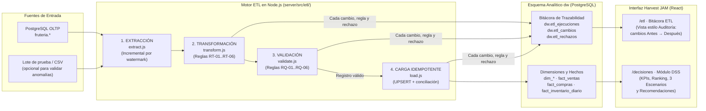

# Proyecto Integrador · Módulo ETL, Bitácora de Cambios y Apoyo a Decisiones (DSS) en Harvest JAM

> **Asignatura:** Desarrollo de Software para la Toma de Decisiones  
> **Modalidad:** A. Integración en proyecto existente (**Harvest JAM 2.0** — Sistema POS e inventario para frutería)  
> **Stack conservado:** React 19 + Vite · Node.js + Express 5 · PostgreSQL (misma base de datos, nuevo esquema `dw`)

---

## 1. Introducción y Planteamiento del Problema

### 1.1 Ficha del proyecto

| Elemento | Definición |
|---|---|
| **Sistema base** | **Harvest JAM 2.0** (POS, compras, inventario, catálogos, reportes y auditoría) |
| **Módulo a integrar** | **Harvest JAM DSS + Motor ETL** (Reposición inteligente de inventario y bitácora de transformaciones) |
| **Decisión concreta** | **¿Qué productos perecederos deben reabastecerse esta semana, en qué cantidad sugerida, con qué prioridad y bajo qué escenario de presupuesto/demanda?** |
| **Usuarios decisores** | `Comprador` (arma pedidos a proveedores), `Gerente` (valida presupuesto y prioridades), `Administrador` (configura reglas y ejecuta el ETL), `Contador` (concilia costos y márgenes) |
| **Frecuencia de decisión** | Diaria (cierre de turno) y semanal (planeación de compra en central de abastos) |
| **Alternativas consideradas** | (1) Reabastecer de emergencia hoy, (2) Incluir en compra programada de la semana, (3) Posponer compra por cobertura suficiente, (4) Ajustar pedido ante tope presupuestal o alza de costos |
| **Naturaleza** | Extensión DSS explicable sobre sistema transaccional existente; **recomienda con evidencia, nunca compra ni autoriza automáticamente** |

### 1.2 Problemática real
Harvest JAM ya captura con precisión cada venta (`venta`, `detalle_venta`), cada compra (`compra`, `detalle_compra`) y la existencia actual (`producto.existencia`), además de mostrar reportes descriptivos. Sin embargo, los datos operativos por sí solos **no responden automáticamente una decisión crítica en una frutería**:

- Comprar **de menos** provoca desabasto en productos de alta rotación y pérdida de ventas.
- Comprar **de más** en frutas y verduras genera **merma** por perecibilidad y congela efectivo.
- Los reportes actuales muestran alertas planas (`existencia <= 10`), sin distinguir si `10 kg` de un producto duran **2 días** (alta demanda) o **25 días** (baja rotación), ni cuánto margen aporta cada producto, ni cómo cambia la necesidad si sube la demanda un 20 % o aumenta el costo de compra.
- Los datos históricos pueden contener inconsistencias (textos sin normalizar, ventas canceladas, registros sin costo actualizado, o lotes externos/simulados con anomalías) que deben limpiarse y auditarse **antes** de calcular indicadores.

### 1.3 Separación explícita: sistema preexistente vs. módulo nuevo

| Capa | Preexistente en Harvest JAM 2.0 | Nuevo para Proyecto Integrador (ETL + DSS) |
|---|---|---|
| **Base de datos** | Esquema `fruteria` (13 tablas OLTP, triggers de stock y `fruteria.auditoria`) | Esquema `dw` dentro de la misma BD PostgreSQL (staging, dimensiones, hechos, `dw.etl_ejecuciones`, `dw.etl_cambios`, `dw.etl_rechazos`, `dw.dss_escenarios`) |
| **Backend (`server/src/`)** | Rutas CRUD y reportes descriptivos | Motor `server/src/etl/` (E→T→V→L), capa pura `server/src/dss/reposicion.js`, rutas `/api/etl` y `/api/decisiones`, permisos `VER_DECISIONES`, `EJECUTAR_ETL`, `VER_BITACORA_ETL` |
| **Frontend (`client/src/`)** | POS (`/vender`), catálogos, `/reportes`, `/auditoria` | Pantalla **`/decisiones`** (tablero DSS, escenarios y ranking explicable) y pantalla **`/etl`** (**Bitácora ETL estilo Auditoría** para ver cada cambio, regla y rechazo) |

---

## 2. Objetivos

### 2.1 Objetivo general
Diseñar e integrar en **Harvest JAM** un pipeline **ETL reproducible con trazabilidad completa** y un **módulo explicable de apoyo a decisiones (DSS)** que convierta el historial operativo de ventas, compras e inventario en indicadores verificables, prioridades de reabastecimiento y comparaciones de escenarios dentro de la misma plataforma web.

### 2.2 Objetivos específicos (alineados a las 5 unidades del temario)
1. **Fundamentos DSS (Unidad 1):** Delimitar la decisión de reabastecimiento de inventario, los roles decisores, las alternativas y las reglas de negocio que separan la recomendación de la autorización humana.
2. **Datos y Modelado (Unidad 2):** Definir el diccionario de datos, al menos 5 indicadores trazables (fórmula, fuente, periodicidad y exclusiones) y el modelo dimensional en esquema `dw`.
3. **Procesos ETL (Unidad 3):** Implementar un flujo modular **Extracción → Transformación → Validación → Carga** idempotente que limpie inconsistencias, aísle datos inválidos en cuarentena y registre cada cambio *Antes → Después*.
4. **Visualización y Análisis (Unidad 4):** Construir dos vistas integradas en la estética de Harvest JAM: un tablero de **Decisiones y Escenarios** (`/decisiones`) y una **Bitácora ETL** (`/etl`) con filtros y detalle comparable a `/auditoria`.
5. **Integración y Validación (Unidad 5):** Integrar el módulo respetando los roles de PostgreSQL/Express, sin duplicar servidores ni bases de datos, y verificarlo con una matriz de pruebas (datos normales, faltantes, inconsistentes y casos límite).

---

## 3. Diccionario de Datos y Variables Relevantes

| Variable | Tipo | Fuente en Harvest JAM | Significado | Validaciones / Reglas de calidad |
|---|---|---|---|---|
| `codigo` | `integer` | `fruteria.producto` | Identificador único del producto | Obligatorio, entero positivo; si falta o no existe en catálogo → rechazo (`RQ-01`) |
| `descripcion` | `varchar(100)` | `fruteria.producto` | Nombre del producto | Recorte de espacios, colapso de dobles espacios, capitalización uniforme (`RT-01`) |
| `categoria` | `varchar(50)` | `fruteria.producto` | Clasificación (`fruta`, `verdura`, etc.) | Normalizada en minúsculas sin acentos sobrantes; nulo → `'sin_clasificar'` con aviso (`RT-02`) |
| `unidad_medida` | `varchar(20)` | `fruteria.producto` | Unidad (`kilogramo`, `pieza`, `manojo`, `charola`, etc.) | Homologación de abreviaturas (`kg` → `kilogramo`, `pza` → `pieza`) (`RT-03`) |
| `existencia` | `numeric(10,3)` | `fruteria.producto` | Stock disponible actual | No puede ser negativo; negativo → cuarentena (`RQ-02`) |
| `precio_c` / `precio_v` | `numeric(8,2)` | `fruteria.producto` | Costo de compra y precio de venta | `precio_v > 0`, `precio_c >= 0`; si `precio_c >= precio_v` → alerta de margen negativo/cero (`RQ-03`) |
| `cantidad_vendida` | `numeric(10,3)` | `fruteria.detalle_venta` | Unidades vendidas por ticket | Debe ser `> 0`; si no es fraccionable y trae decimal → aviso/corrección documentada (`RQ-04`) |
| `fecha_venta` | `timestamp` | `fruteria.venta` | Fecha y hora de emisión del ticket | No nula, no futura (`fecha <= now()`); fechas inválidas → cuarentena (`RQ-05`) |
| `proveedor_principal` | `varchar(100)` | `fruteria.producto_proveedor` + `proveedor` | Quién surte el producto y última compra | Si un producto no tiene proveedor ligado → aviso en recomendación (`RQ-06`) |
| `origen_dato` | `varchar(20)` | Metadato ETL | Distingue `'operativo'`, `'simulado'` o `'lote_prueba'` | Cumple el requisito de identificar claramente datos reales vs. simulados |

---

## 4. Arquitectura y Proceso por Proceso del ETL



### Proceso 1 · Apertura de Corrida y Extracción (`extract.js`)
1. Se inserta una nueva fila en `dw.etl_ejecuciones` con `estado = 'en_curso'`, `modo` (`incremental`, `completo` o `prueba_calidad`) y `ejecutado_por` (usuario de sesión de Harvest JAM).
2. Se leen las marcas de agua en `dw.etl_watermarks` (`ultimo_folio_v`, `ultimo_folio_c`, `ultima_fecha`).
3. Se extraen de `fruteria`:
   - Catálogos completos (`producto`, `proveedor`, `producto_proveedor`, `cliente + p_fisica + p_moral`, `empleado + supervisor`).
   - Ventas nuevas (`folio_v > ultimo_folio_v`) y compras nuevas (`folio_c > ultimo_folio_c`), más la lista de folios vigentes para detectar cancelaciones.
4. *(Opcional para demostración)* Si el administrador ejecuta el modo **`prueba_calidad`** o sube un archivo CSV, se inyectan registros crudos en memoria/staging para evidenciar cómo el ETL limpia anomalías y rechaza datos inválidos sin contaminar `fruteria`.

### Proceso 2 · Limpieza y Transformación (`transform.js`)
Cada modificación que sufre un dato **genera automáticamente un evento estructurado en memoria** para guardarse en `dw.etl_cambios` (`entidad`, `clave_origen`, `campo`, `tipo_evento`, `regla`, `valor_antes`, `valor_despues`, `motivo`):

| Regla | Tipo de evento | Qué hace | Ejemplo `Antes → Después` |
|---|---|---|---|
| **RT-01** | `NORMALIZADO` | Limpia espacios extra y unifica formato de texto en descripciones y nombres | `"  manzana   ROJA "` → `"Manzana roja"` |
| **RT-02** | `NORMALIZADO` | Homologa categorías a vocabulario controlado | `"FRUTAS "` → `"fruta"` |
| **RT-03** | `CORREGIDO` | Unifica alias de unidades de medida | `"kg"` / `"kilo"` → `"kilogramo"` |
| **RT-04** | `UNIFICADO` | Consolida `cliente` + `p_fisica` + `p_moral` y clasifica `mostrador` (`XAXX010101000`) | 3 tablas → 1 registro en `dw.dim_cliente` |
| **RT-05** | `DEDUPLICADO` | Detecta renglones duplicados (`folio + codigo`) en lotes externos y conserva el válido | 2 renglones repetidos → 1 renglón consolidado |
| **RT-06** | `ENRIQUECIDO` | Calcula `importe_bruto`, `costo_unitario_ref`, `margen_estimado`, `fecha_sk` y `hora` | `2.5 kg × $32` → `importe: $80.00, margen: $22.50` |

### Proceso 3 · Validación y Cuarentena (`validate.js`)
Ningún dato inválido pasa al modelo de decisiones ni rompe la corrida completa:

| Regla | Condición detectada | Acción del ETL | Registro en Bitácora |
|---|---|---|---|
| **RQ-01** | Producto sin código o código inexistente en catálogo | **Rechazar** renglón (`dw.etl_rechazos`) | Evento `RECHAZADO` con payload JSON original |
| **RQ-02** | `existencia < 0` o `cantidad <= 0` | **Rechazar** renglón | Evento `RECHAZADO` ("Cantidad inválida ≤ 0") |
| **RQ-03** | `precio_v <= 0` o `precio_c < 0` | **Rechazar** si `precio_v <= 0`; marcar **Alerta** si `precio_c >= precio_v` | Evento `RECHAZADO` o `ALERTA_CALIDAD` |
| **RQ-04** | Fecha nula, mal formada o futura (`> hoy`) | **Rechazar** movimiento | Evento `RECHAZADO` ("Fecha fuera de rango") |
| **RQ-05** | Valor faltante no crítico (ej. `precio_unitario` nulo en detalle histórico) | **Corregir** usando `producto.precio_v` vigente y documentar supuesto | Evento `CORREGIDO` (`null → $45.00`) |
| **RQ-06** | Producto sin ventas en la ventana analizada | Cargar con marca `datos_insuficientes = true` | El DSS advierte explícitamente falta de historial |

### Proceso 4 · Carga Idempotente y Conciliación (`load.js`)
Dentro de una transacción (`BEGIN ... COMMIT`):
1. `UPSERT` en `dw.dim_tiempo`, `dw.dim_producto`, `dw.dim_cliente`, `dw.dim_empleado`, `dw.dim_proveedor`.
2. `UPSERT` en `dw.fact_ventas` y `dw.fact_compras` (si se corre 2 veces seguidas, el resultado es idéntico).
3. Sincronización de bajas: elimina de `dw.fact_ventas` / `dw.fact_compras` los folios cancelados en `fruteria`, registrando un evento `SINCRONIZADO_BAJA` en `dw.etl_cambios`.
4. Snapshot diario en `dw.fact_inventario_diario` (existencia, valor a costo, valor a venta, estado de stock).
5. Inserción masiva de todos los eventos recopilados en `dw.etl_cambios` y `dw.etl_rechazos`.
6. **Conciliación contable automática:** compara `SUM(fruteria.detalle_venta)` contra `SUM(dw.fact_ventas)` y guarda `conciliacion_ok` (`true`/`false`) y `diferencia_pesos` en `dw.etl_ejecuciones`.
7. Actualiza `dw.etl_watermarks` y cierra la corrida en `dw.etl_ejecuciones` con tiempo total en milisegundos.

---

## 5. Modelo de Apoyo a Decisiones (DSS) sobre los Datos del ETL

Toda la lógica vive en una capa pura y testeable (`server/src/dss/reposicion.js`), separada de los componentes visuales.

### 5.1 Indicadores trazables (5 indicadores obligatorios)

| Indicador | Fórmula | Fuente (`dw`) | Exclusiones / Notas |
|---|---|---|---|
| **1. Demanda diaria promedio (DDP)** | `Σ cantidad_vendida / días_ventana` | `dw.fact_ventas` | Ventana configurable (14, 30 o 60 días); excluye ventas canceladas y registros rechazados |
| **2. Días de cobertura** | `existencia_actual / DDP` | `dw.fact_inventario_diario` + `dw.fact_ventas` | Si `DDP = 0`, se marca como `Sin demanda reciente` (no se divide entre cero) |
| **3. Índice de rotación** | `Σ cantidad_vendida_periodo / MAX(existencia_promedio, 1)` | `dw.fact_ventas` + `dw.fact_inventario_diario` | Mide velocidad de salida del producto |
| **4. Margen de contribución** | `Σ (importe_bruto - costo_estimado)` y `% margen = (precio_v - precio_c) / precio_v × 100` | `dw.fact_ventas` + `dw.dim_producto` | Permite priorizar productos que además de rotar sostienen la rentabilidad |
| **5. Cantidad y costo sugerido de compra** | `max(0, ceil((DDP × dias_objetivo × factor_demanda) - existencia_actual)) × costo_unitario` | Parámetros de escenario + `dw.dim_producto` | Se redondea al múltiplo comercial (entero en piezas, 0.5 kg en granel) |

### 5.2 Modelo explicable de puntuación de prioridad (0 a 100)

Cada producto con historial suficiente recibe una puntuación transparente:

$$\text{Prioridad} = 0.40 \cdot R_{\text{desabasto}} + 0.30 \cdot D_{\text{demanda}} + 0.20 \cdot M_{\text{margen}} + 0.10 \cdot B_{\text{brecha}}$$

Donde cada factor se normaliza en el rango $[0, 100]$:
- **$R_{\text{desabasto}}$ (40 %):** Qué tan cerca está la cobertura de agotarse respecto al tiempo de entrega/ciclo de compra (por ejemplo, `cobertura <= 2 días` → `100`; `>= 10 días` → `0`).
- **$D_{\text{demanda}}$ (30 %):** Demanda diaria relativa frente al máximo de su categoría.
- **$M_{\text{margen}}$ (20 %):** Contribución monetaria del producto en el periodo.
- **$B_{\text{brecha}}$ (10 %):** Qué tan por debajo está respecto al umbral mínimo (`UMBRAL_STOCK_BAJO`).

**Reglas de salvaguarda (siguiendo el documento del Proyecto Integrador):**
- **Tratamiento de emergencia:** Si `existencia == 0` y tuvo ventas en los últimos 30 días, se clasifica inmediatamente como **`EMERGENCIA (Agotado con demanda)`**, sin depender solo del promedio ponderado.
- **Datos insuficientes:** Si un producto no tiene ventas registradas ni historial en la ventana elegida, se etiqueta **`Sin sustento suficiente`** en lugar de emitir una recomendación categórica.
- **Pesos configurables:** Los pesos (`0.40 / 0.30 / 0.20 / 0.10`) pueden ajustarse desde parámetros en el análisis y se muestran explícitamente junto a cada resultado.

### 5.3 Comparación de 3 escenarios financieros y operativos

| Escenario | Parámetros modificables | Qué recalcula el sistema |
|---|---|---|
| **1. Base (Normal)** | Demanda `100 %`, Costo `100 %`, Cobertura objetivo `7 días`, Presupuesto libre | Pedido sugerido estándar, inversión total y margen esperado |
| **2. Alta demanda (Fin de semana / Temporada)** | Demanda `+20 %`, Costo `100 %`, Cobertura objetivo `7 días` | Qué productos pasan de prioridad Media a Alta y cuánto capital adicional se requiere |
| **3. Escenario adverso (Alza de costo + Tope presupuestal)** | Demanda `100 %`, Costo `+15 %`, Tope de presupuesto (ej. `$8,000`) | Ordena por mayor puntuación de prioridad hasta cubrir el presupuesto e indica qué productos conviene posponer sin paralizar las ventas clave |

### 5.4 Ejemplo de recomendación explicable
> **Priorizar compra de Cebolla (Prioridad 91/100 · Alta):**  
> Quedan **5 kg** y la demanda promedio de los últimos 30 días es de **3.2 kg/día** (cobertura estimada de **1.6 días**, menor al ciclo de 3 días). Margen actual de **38 %**.  
> **Sugerencia en Escenario Base:** comprar **18 kg** (costo estimado **$324.00**) con proveedor *Agrícola del Norte*.  
> *Supuestos:* ventana de 30 días, demanda normal (100 %), datos conciliados de la corrida ETL #12. *La autorización y registro final permanecen a cargo del comprador.*

---

## 6. La Vista de Bitácora ETL (Estilo Auditoría)

Para que el ETL sea **totalmente visible, auditable y demostrable** durante la operación y la presentación final, se integrará una pantalla dedicada **`/etl`** siguiendo exactamente el patrón visual de [Auditoria.jsx](../client/src/paginas/Auditoria.jsx) (Obsidian Atelier & Champagne Gold):

### 6.1 Estructura de la pantalla `/etl`

1. **Cabecera de acción:**
   - Título: **Bitácora ETL y Calidad de Datos**
   - Descripción: *"Registro trazable de cada extracción, limpieza, corrección, rechazo y carga hacia el Data Warehouse."*
   - Acciones (según permiso `EJECUTAR_ETL`):
     - Botón secundario: **Probar lote con anomalías** (corre un lote de prueba controlado con duplicados, texto sucio, precio negativo y fecha futura para demostrar en vivo cómo responde el ETL).
     - Botón primario dorado: **Ejecutar ETL ahora**.

2. **Banda resumen de la corrida seleccionada (`cifras cifras--fila`):**
   - **Estado y Conciliación:** `OK · Cuadrado 100 %` (o alerta si hubo rechazos)
   - **Filas extraídas**
   - **Transformadas / Corregidas**
   - **Cargadas en `dw`**
   - **Rechazadas (Cuarentena)**
   - **Duración** (ej. `142 ms`)

3. **Filtros (misma UX que `Auditoria.jsx`):**
   - Selector de **Corrida** (`Todas las corridas` o `Corrida #15 · Hoy 12:10 · Incremental`).
   - Segmentado de **Entidad**: `Todo` | `Productos` | `Ventas` | `Compras` | `Clientes` | `Inventario`.
   - Segmentado de **Tipo de cambio** (con conteos):
     - `Todos`
     - `Normalizados` *(acento champagne gold)*
     - `Corregidos` *(ámbar)*
     - `Deduplicados` *(azul info)*
     - `Rechazados` *(rubí crítico)*
     - `Cargados` *(verde esmeralda)*
   - Buscador libre por clave (`#104`, `5102`), regla (`RT-01`, `RQ-02`) o descripción.

4. **Tabla paginada de cambios (`Tabla.jsx`) con vista *Antes → Después*:**

| Cuándo | Corrida | Entidad / Clave | Tipo de cambio | Regla | Cambio (`Antes → Después`) | Motivo |
|---|---|---|---|---|---|---|
| Hoy, 12:10 | `#15` | Productos · `5104` | ● Normalizado | `RT-01` | `"  cebolla  BLANCA "` → `"Cebolla blanca"` | Limpieza de espacios y capitalización |
| Hoy, 12:10 | `#15` | Productos · `5112` | ● Corregido | `RT-03` | `"kg"` → `"kilogramo"` | Homologación de unidad de medida |
| Hoy, 12:10 | `#15` | Ventas · `#289` | ● Deduplicado | `RT-05` | `2 renglones` → `1 renglón` | Renglón duplicado en lote externo |
| Hoy, 12:10 | `#15` | Ventas · `#999` | ● Rechazado | `RQ-02` | `cantidad: -3` → *(Cuarentena)* | Cantidad menor o igual a cero |
| Hoy, 12:10 | `#15` | Inventario · `54` | ● Cargado | `LD-01` | `Snapshot diario` → `$72,578.00` | Corte diario registrado en `dw` |

5. **Modal de inspección al hacer clic en cualquier fila:**
   - Muestra el **JSON crudo de entrada**, el **JSON limpio de salida**, la **regla exacta** con su explicación, el **usuario que disparó la corrida** y el **impacto** (si el registro entró al cálculo del DSS o fue excluido en cuarentena).

---

## 7. Dónde y Cómo se Implementa Exactamente en Este Repositorio

Manteniendo 100 % las convenciones de Harvest JAM (sin frameworks extra, sin duplicar la base de datos):

```text
harvest-jam/
├── base-de-datos/
│   ├── 01_tablas.sql ... 06_datos_simulados.sql   (intactos)
│   └── 07_etl_dss.sql                             <-- NUEVO: esquema dw, tablas etl_ejecuciones,
│                                                      etl_cambios, etl_rechazos, dim_*, fact_* y permisos
├── server/
│   └── src/
│       ├── permisos.js                            <-- EDITAR: agregar VER_DECISIONES, EJECUTAR_ETL, VER_BITACORA_ETL
│       ├── app.js                                 <-- EDITAR: montar /api/etl y /api/decisiones
│       ├── etl/                                   <-- NUEVO: motor ETL modular
│       │   ├── index.js                           (orquestador transaccional + conciliación)
│       │   ├── extract.js                         (lectura incremental desde fruteria.*)
│       │   ├── transform.js                       (reglas RT-01..RT-06 con log Antes → Después)
│       │   ├── validate.js                        (reglas RQ-01..RQ-06 y cuarentena)
│       │   ├── load.js                            (UPSERT idempotente + snapshot + bajas)
│       │   └── lotePrueba.js                      (lote con anomalías controladas para demo/pruebas)
│       ├── dss/                                   <-- NUEVO: capa pura y testeable de decisión
│       │   └── reposicion.js                      (5 KPIs, puntuación 0-100, 3 escenarios, explicaciones)
│       └── rutas/
│           ├── etl.js                             <-- NUEVO: GET /api/etl/corridas, GET /api/etl/cambios,
│           │                                          POST /api/etl/ejecutar, POST /api/etl/probar-anomalias
│           └── decisiones.js                      <-- NUEVO: GET /api/decisiones/reposicion?ventana=30&demanda=1.2...
└── client/
    └── src/
        ├── App.jsx                                <-- EDITAR: registrar rutas /decisiones y /etl
        ├── componentes/Layout.jsx                 <-- EDITAR: agregar "Decisiones" y "Bitácora ETL" en grupo Análisis
        └── paginas/
            ├── Decisiones.jsx                     <-- NUEVO: tablero DSS, comparador de 3 escenarios,
            │                                          ranking explicable y enlace a /compras/nueva
            └── BitacoraEtl.jsx                    <-- NUEVO: vista estilo Auditoría con cambios Antes → Después
```

### Permisos por rol (doble capa: `permisos.js` + PostgreSQL)

| Rol | `/decisiones` (DSS) | `/etl` (Ver Bitácora) | Ejecutar ETL / Prueba |
|---|---|---|---|
| `administrador` | Ver y simular | Ver | Sí |
| `gerente` | Ver y simular | Ver | No (solo consulta) |
| `contador` | Ver y simular | Ver | No (solo consulta) |
| `comprador` | Ver y simular | No | No (usa recomendaciones para `/compras/nueva`) |
| `cajero` / `admin_clientes` | Sin acceso | Sin acceso | No |

---

## 8. Matriz de Pruebas y Criterios de Aceptación

| Caso de prueba | Entrada | Resultado esperado | Evidencia verificable |
|---|---|---|---|
| **P-01 · Carga inicial completa** | Datos de `fruteria` (`05_datos` + `06_datos_simulados`) | Todas las dimensiones y hechos cargan con `estado = 'ok'` y `conciliacion_ok = true` | Fila en `dw.etl_ejecuciones` + cuadre `OLTP === DW` |
| **P-02 · Idempotencia** | Ejecutar ETL 2 veces seguidas sin nuevas ventas | 0 duplicados; totales de `fact_ventas` idénticos | Suma de importes sin variación |
| **P-03 · Dato sucio normalizable** | Producto `"  fresa  ROJA "` con unidad `"kg"` | Se normaliza a `"Fresa roja"` / `"kilogramo"` y entra a `dw` | Registro `NORMALIZADO` (`RT-01`) y `CORREGIDO` (`RT-03`) en `/etl` |
| **P-04 · Dato inválido (cuarentena)** | Renglón de venta con `cantidad = -2` o fecha futura `2099-01-01` | Se bloquea su carga a `dw.fact_ventas`, se guarda en `dw.etl_rechazos` y la corrida continúa | Registro `RECHAZADO` (`RQ-02` / `RQ-05`) visible en `/etl` |
| **P-05 · Registro duplicado** | Dos renglones idénticos `(folio, codigo)` en lote de prueba | Se conserva 1 solo renglón y se documenta la deduplicación | Registro `DEDUPLICADO` (`RT-05`) en `/etl` |
| **P-06 · Producto sin historial** | Producto nuevo con `0` ventas en 30 días | El DSS lo marca `Sin sustento suficiente` en lugar de dar prioridad falsa | Etiqueta y explicación explícita en `/decisiones` |
| **P-07 · Caso límite (Agotado)** | Producto con `existencia = 0` y demanda > 0 | Aparece primero como `EMERGENCIA` independientemente de los pesos | Posición #1 en tabla de `/decisiones` |
| **P-08 · Comparación de escenarios** | Cambiar demanda de `100 %` a `+20 %` y aplicar tope de presupuesto | Recalcula cantidades, inversión total y señala qué productos se posponen | Tarjetas comparativas de 3 escenarios en `/decisiones` |
| **P-09 · Venta cancelada** | Cancelar una venta en `/ventas` y correr ETL | Se elimina de `dw.fact_ventas` y se mantiene la conciliación | Evento `SINCRONIZADO_BAJA` en `/etl` + `conciliacion_ok = true` |
| **P-10 · Seguridad por rol** | Iniciar sesión como `cajero` e intentar abrir `/etl` o `/decisiones` | Bloqueado en menú, frontend y API (`403 Forbidden`) | Pantalla de acceso restringido + prueba HTTP 403 |

---

## 9. Plan de Iteraciones y Guion de Demostración Final

### Plan de 4 iteraciones (alineado al documento integrador)
1. **Iteración 1 (Alcance y Modelado):** Aprobar este documento, crear `base-de-datos/07_etl_dss.sql`, actualizar roles y ejecutar migración sobre PostgreSQL.
2. **Iteración 2 (Motor ETL + Bitácora `/etl`):** Implementar `server/src/etl/*`, endpoints `/api/etl/*`, lote de prueba con anomalías y la pantalla **`BitacoraEtl.jsx`** estilo Auditoría.
3. **Iteración 3 (Modelo DSS + Escenarios `/decisiones`):** Implementar `server/src/dss/reposicion.js`, `/api/decisiones`, y la pantalla **`Decisiones.jsx`** con indicadores, 3 escenarios y recomendaciones explicables conectadas a `/compras/nueva`.
4. **Iteración 4 (Pruebas y Defensa):** Correr pruebas automatizadas de `reposicion.js` y `etl/`, llenar evidencias de la matriz de pruebas y preparar el recorrido de demostración.

### Guion exacto de los 7 pasos para la demostración final (Sección 14)
1. **Describir la decisión:** Mostrar el problema de reposición de perecederos en Harvest JAM y los roles involucrados.
2. **Mostrar los datos de entrada:** Abrir `/productos` y `/ventas` en Harvest JAM para enseñar existencias actuales e historial operativo.
3. **Explicar una transformación y un dato inválido del ETL:** Entrar a **`/etl`**, pulsar **"Ejecutar ETL"** y **"Probar lote con anomalías"**, filtrar por `Normalizados` y `Rechazados`, y abrir un registro para mostrar `Antes → Después`, regla aplicada y cuarentena.
4. **Presentar los indicadores:** Entrar a **`/decisiones`** y mostrar los 5 KPIs trazables (DDP, días de cobertura, rotación, margen y costo de reposición) con su fórmula y fecha de corte.
5. **Ejecutar el modelo:** Revisar el ranking de prioridad `0–100`, la regla de `EMERGENCIA` para agotados y el aviso de `Sin sustento suficiente` para productos sin historial.
6. **Modificar parámetros y comparar escenarios:** Comparar en pantalla **Base vs. Demanda +20 % vs. Presupuesto Restringido** y ver el cambio inmediato en cantidades e inversión.
7. **Justificar una recomendación con datos:** Abrir la explicación detallada de un producto prioritario y mostrar cómo el comprador decide pasar a `/compras/nueva` (confirmando que la decisión final siempre es humana).
